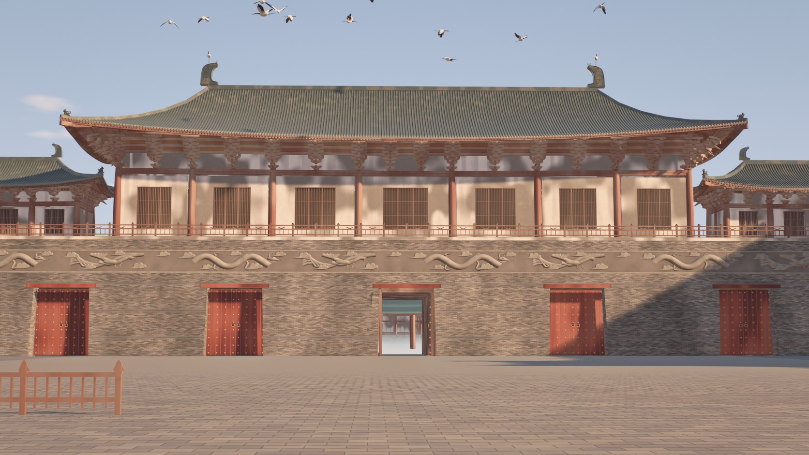

# 东京梦华

A walkable, real-time reconstruction of Kaifeng, the Northern Song capital, around 1120, that runs in a browser. No external assets: every mesh, texture and shader is generated in code. Building proportions come from the 1103 manual 《营造法式》, and the layout from 《东京梦华录》 and excavation reports.



## What's in it

The palace axis, about 1.4 km × 2 km, with the city running to the horizon:

- **宣德楼:** the palace gate, with five doors, one open so you can walk through
- **御街:** the imperial avenue at its recorded width of 312 m, with canals, lotus, blossom trees, fences and corridors
- **州桥:** a low column-and-beam stone bridge with carved river walls, over the 汴河
- **大庆殿:** the main hall in its vast court, surrounded by the palace
- **The city:** inner-city roofs, 朱雀门, the inner wall, and 铁塔 on the skyline
- **20 cranes** circling the gate roof, after 《瑞鹤图》 (1112)

There are no people yet.

## Controls

| Key | Action |
|---|---|
| Click | Capture the mouse to look around |
| W A S D | Move |
| F | Switch between walking and flying |
| E / Q | Up and down when flying |
| Shift | Move 5× faster |
| T | Change the time of day: morning, sunset, blue hour |
| V | Evidence view: what is excavated, documented or inferred |
| R | Change the quality tier |

Stand still and the image refines itself over a few seconds.

## Running it

```bash
npm ci
node tools/serve.mjs        # development, at http://localhost:8080/
node tools/build.mjs        # static site in dist/, upload it to any host
```

Tested in headless Chromium with software rendering only. **Frame rate on a real GPU has not been measured.** The target is about 30 fps at 1080p on an integrated GPU of Radeon 780M class. Phones are out of scope for now.

## How accurate is it?

Press `V` to see for yourself. Excavation gives us 州桥's span and deck and its carved walls, and 铁塔 still stands. 《东京梦华录》 gives the order of things along the avenue and the features of 宣德楼. Most of the rest, including the palace layout, the city blocks and the positions of many buildings, is inferred.

Two figures are deliberately weakly sourced: 州桥 about 400 m south of 宣德楼 comes from a secondary source, and most cross-section widths on the avenue are our own. The sources are in `docs/sources/`, and `docs/ART_BIBLE.md` tags each decision.

## How it was built

Codex (OpenAI) wrote the code. Claude Code (Anthropic) wrote the specs and tests, reviewed the work and validated it by rendering, with Codex sandboxed to this repository. The engine and render tools are adapted from [athenaion](THIRD_PARTY_NOTICES.md) (MIT). The nine reference images in `refs/generated/` are AI-generated look targets, not historical evidence. Historical images are listed in `refs/historical/SOURCES.md`.

## Tests

```bash
npm test                              # 《营造法式》 rules and hall layout
node test/gates/reachability.mjs      # you can walk from 朱雀门 to 大庆殿
node test/gates/moved-camera.mjs      # walking somewhere matches placing the camera there
node test/gates/dist.mjs              # the static site works from a sub-path
```

## What's next

`docs/ROADMAP.md`: crowds, then the rest of the city, including 虹桥, 相国寺, 樊楼, 艮岳 and 金明池. `docs/BACKLOG.md` lists known visual faults.
