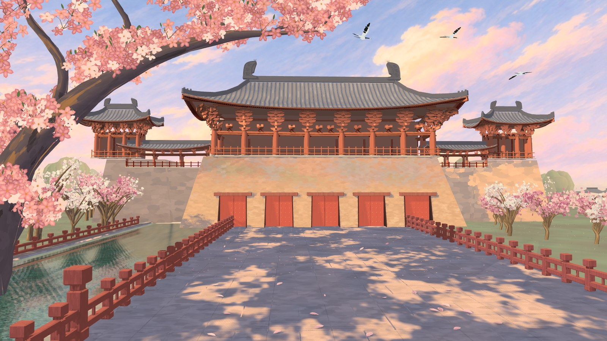
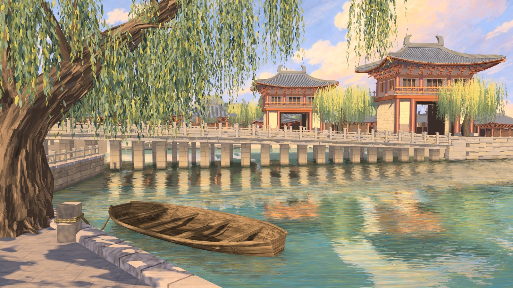
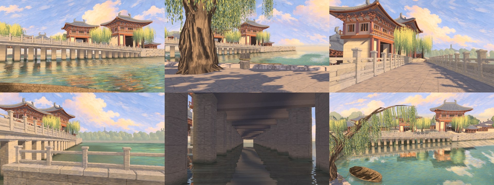

# 东京梦华

An impression of Kaifeng, the Northern Song capital, around 1120: composed scenes that look like hand-painted animation backgrounds, rendered in real time in a browser. You drift through them like a handscroll being unrolled. It isn't a city to walk across.





## What's in it

Two scenes, with captions from 孟元老's 《東京夢華錄》:

- **宣德楼:** the palace gate, with five vermilion doors with gold nails, a great bracketed hall, blossom, red rails, a canal and cranes
- **州桥:** the low column-and-beam stone bridge, a moored boat, willows, and the towers reflected in the water, seen from seven views



There are no people yet.

## Controls

| Input | Action |
|---|---|
| Nothing | The camera drifts slowly along the scene's path |
| Pointer | Look around: up to 6° to each side and 3° up or down |
| Drag or wheel | Move along the path. Drift resumes a few seconds later |
| ← → or the on-screen arrows | Change scene |
| 1 to 7, or the on-screen list | Change view on 州桥: 河灣, 舟中, 柳下, 橋上, 橋側, 橋下, 遠望 |
| C | Show or hide captions |
| P | Show frame rate, draw calls, triangles, pixel ratio, quality level and GPU |

## Running it

```bash
npm ci
node tools/serve.mjs        # development, at http://localhost:8080/
node tools/build.mjs        # static site in dist/, upload it to any host
```

`?scene=0` or `?scene=1` opens a scene directly. `?scene=1&view=6` opens a view of 州桥.

An earlier, less detailed version ran at 60 FPS, locked to vsync, on an RTX 3070 Laptop GPU. This version costs less than that one in software tests, but hasn't been measured on a real GPU yet. Press `P` to see it. Every view is at most 36 draw calls and about 1.1 million triangles.

If a machine can't keep up, the page reduces reflection quality first, then resolution, and recovers when there's room.

## How accurate is it?

Loosely, on purpose. Positions, distances and the width of the avenue are composed for the picture.

The Song details stay strict, because they're cheap and they stop this becoming generic fantasy China: large brackets, deep and gently curved eaves, 鸱尾 with 拒鹊子, flat timber gate lintels rather than round arches, a low column-and-beam 州桥, no yellow roofs and no Qing forms. The five doors with gold nails come straight from the text, and the sources are in `docs/sources/`.

The caption text is quoted from 《東京夢華錄》. The English glosses are ours.

## How it was built

Codex (OpenAI) wrote the code. Claude Code (Anthropic) wrote the specs and tests, reviewed the work and validated it by rendering, with Codex sandboxed to this repository. The engine and render tools are adapted from [athenaion](THIRD_PARTY_NOTICES.md) (MIT).

Buildings, water, trees and everything near are generated in code, and the sunlight on both scenes is a shadow map baked once at load. Only the sky and far distance are painted images, in `assets/backdrops/`. Those images and the look targets in `refs/style/` are AI-generated, and they aren't historical evidence. Historical images are listed in `refs/historical/SOURCES.md`.

## Tests

```bash
npm test                              # 《营造法式》 rules and hall layout
node tools/build.mjs
node test/gates/scroll.mjs            # the scroll works from a sub-path of the static site
python3 -I test/gates/detail.py c1 <render.png>     # surface detail against a target
python3 -I test/gates/regions.py c1 <render.png>    # regional values against a target
python3 -I test/gates/shimmer.py <frames-dir>       # flicker on consecutive frames from a fixed camera
python3 -I test/gates/crops.py c1 <render.png> <dir> # target above render, region by region
python3 -I test/gates/colour.py <render.png>         # colour of 州桥's water and willows against the target
python3 -I test/gates/look-zhou.py <view1.png>       # 州桥, one material at a time, against c2
python3 -I test/gates/look-xuande.py <f0.png>        # 宣德楼, one material at a time, against c1
node test/gates/perf.mjs                             # frame cost in software, to compare versions
node test/gates/views.mjs                            # every view of 州桥: holes, budget and controls, and 宣德楼 unchanged
```

## The earlier version

Before this, the project was a photoreal, walkable reconstruction of the palace axis at its real scale. It's finished, and `?world=1` still opens it. It lost out because the city was too big to travel and photorealism was where procedural work looked weakest.

## What's next

`docs/ROADMAP.md` says what's waiting on a decision. `docs/BACKLOG.md` lists known visual faults.
